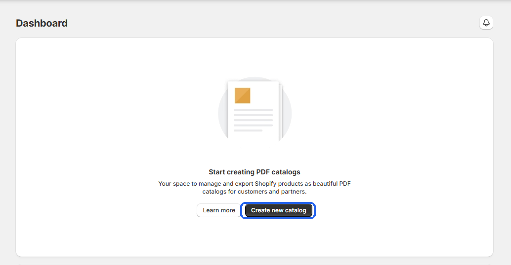
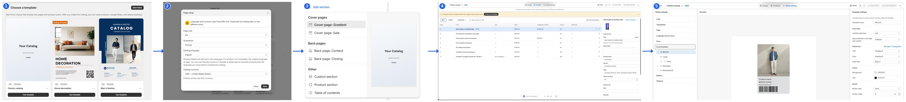

**Page name:** Create your first catalog
**Short description:** Build your first PDF catalog — choose a template, design your pages, edit products, and set catalog-wide options.

---

# Create your first catalog

*Choose a template, Page setup, Design, Products, Global settings*

# Goal
Create your first catalog and set it up end to end: pick a starting point, lock in its page setup, design its pages, edit its products, and set its catalog-wide options.

# Where to see & edit

From the **Dashboard**, click **Create new catalog**.

# What you can do

1. **Choose a template** — Pick a ready-made layout (for example **Classic catalog**, **Home decoration**, **Men's fashion**), or click **Start blank** to design from scratch.
2. **Set page setup** — Choose **Page size**, **Orientation**, **Catalog language**, and **Catalog currency**.
   - Language and currency stay fixed after this. Duplicate the catalog later to use different ones.
3. **Design your pages** — Click **Add section** to add **Cover**, **Back**, **Product**, or **Custom** pages, then **Add block** (Text, Shape, Line, Image, Button, QR code, Product card) to build each one.
4. **Edit your products** — Go to the **Products** tab to edit product details for this catalog (title, description, product type, vendor, tags, total inventory, variant info) without changing your store. Click **Sync from Shopify** to pull in the latest store data, and **Reset to Shopify** to undo an edited field.
5. **Set global settings** — Go to the **Global settings** tab to set options that apply to the whole catalog: **Logo**, **Typography**, **Page**, **Language and currency**, **Price**, **Card templates**, **Buttons**, **Flipbook**.

# Troubleshooting

| Case | Issue | Solution |
|---|---|---|
| **Overflowing page** | A warning reads "Some product pages overflow the printable area," with a link to the affected page. | Open the linked page and reduce the number of products, or adjust the layout, so the content fits the printable area. |

# Note
This page covers the overall flow only. For the full settings on each piece — individual blocks, Header and footer, Card templates, and the rest — see their own guide pages.
