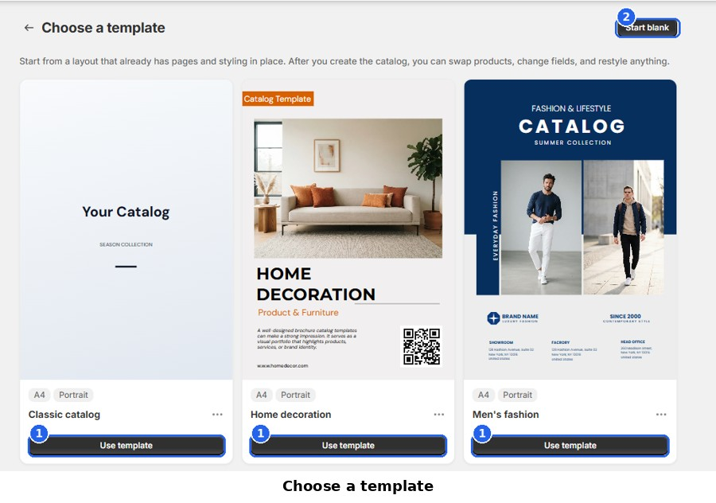
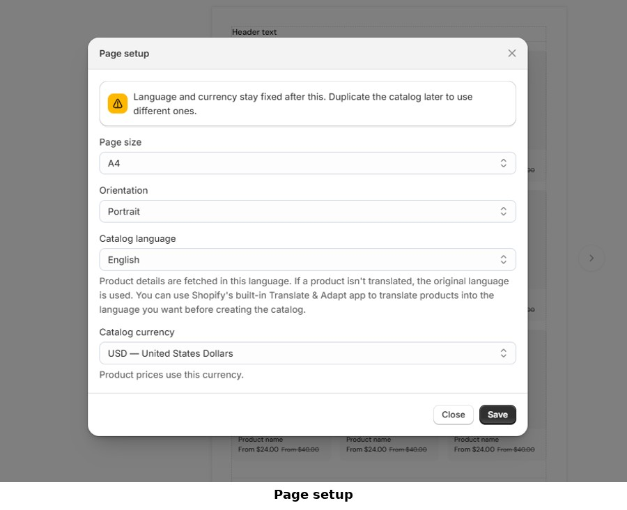
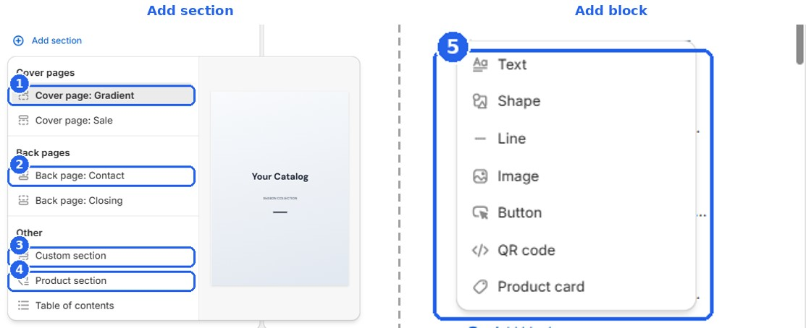
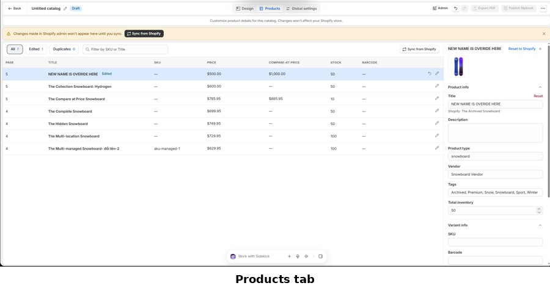
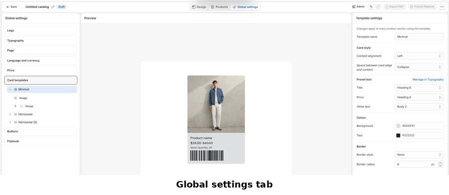

**Page name:** Create your first catalog
**Short description:** Build your first PDF catalog — choose a template, design your pages, edit products, and set catalog-wide options.

---

# Create your first catalog

*Choose a template, Page setup, Design, Products, Global settings*

# Goal
Create your first catalog and set it up end to end: pick a starting point, lock in its page setup, design its pages, edit its products, and set its catalog-wide options.

# Where to see & edit

| Where | Preview |
|---|---|
| From the **Dashboard**, click **Create new catalog**. |  |

# What you can do

| Steps (5) | Preview |
|---|---|
| **1. Choose a template** — pick a layout, then: &nbsp;&nbsp;▸ **Use template** — on **Classic catalog**, **Home decoration**, or **Men's fashion** &nbsp;&nbsp;▸ **Start blank** — design from scratch |  |
| **2. Set page setup** — choose: &nbsp;&nbsp;▸ **Page size** &nbsp;&nbsp;▸ **Orientation** &nbsp;&nbsp;▸ **Catalog language** &nbsp;&nbsp;▸ **Catalog currency** Language and currency stay fixed after this. Duplicate the catalog later to use different ones. |  |
| **3. Design your pages** — click **Add section** to add: &nbsp;&nbsp;▸ **Cover**, **Back**, **Product**, or **Custom** pages then **Add block** (Text, Shape, Line, Image, Button, QR code, Product card) to build each one. |  |
| **4. Edit your products** — in the **Products** tab, edit product details for this catalog (title, description, product type, vendor, tags, total inventory, variant info) without changing your store. &nbsp;&nbsp;▸ **Sync from Shopify** — pull in the latest store data &nbsp;&nbsp;▸ **Reset to Shopify** — undo an edited field |  |
| **5. Set global settings** — in the **Global settings** tab, set options for the whole catalog: &nbsp;&nbsp;▸ **Logo**, **Typography**, **Page**, **Language and currency**, **Price**, **Card templates**, **Buttons**, **Flipbook** |  |

# Note
This page covers the overall flow only. For the full settings on each piece — individual blocks, Header and footer, Card templates, and the rest — see their own guide pages at [documentations.rockcats.site/e/en/apps/rc-ctalog-maker](https://documentations.rockcats.site/e/en/apps/rc-ctalog-maker).
