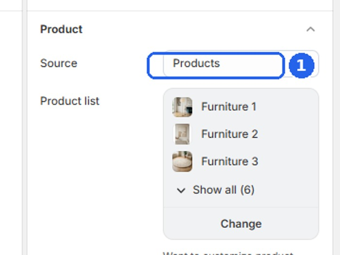
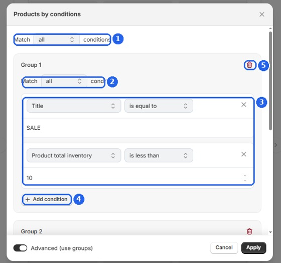

## Page name: How to set up the product page
Set your products, their layout, colors, and the page's header and footer.

---

# How to set up the product page

*Product source, Layout, Page colors, Header, Footer*

# Goal
Set up a product page: choose which products to show, set their layout and colors, and set the page's header and footer.

# Where to see & edit

| Where | Preview |
|---|---|
| In the Design editor, select a **Product section** page. |  |

# What you can do

| Steps (5) | Preview |
|---|---|
| **1. Choose your products** — set **Source**: &nbsp;&nbsp;▸ **Products** — pick products yourself &nbsp;&nbsp;▸ **Products by condition** — match them by rule (see below) |  |
| **2. Set the layout**: &nbsp;&nbsp;▸ **Columns** &nbsp;&nbsp;▸ **Rows** &nbsp;&nbsp;▸ **Space between cards** &nbsp;&nbsp;▸ **Card style** |  |
| **3. Set page colors**: &nbsp;&nbsp;▸ **Background** &nbsp;&nbsp;▸ **Dividers** |  |
| **4. Set the header**: &nbsp;&nbsp;▸ **Header text** &nbsp;&nbsp;▸ **Date** &nbsp;&nbsp;▸ **Show divider line** &nbsp;&nbsp;▸ **Show logo** &nbsp;&nbsp;▸ **Alignment** &nbsp;&nbsp;▸ **Header text** style (Typography) &nbsp;&nbsp;▸ **Date** style (Typography) &nbsp;&nbsp;▸ **Header text** color (Colors) &nbsp;&nbsp;▸ **Date** color (Colors) |  |
| **5. Set the footer**: &nbsp;&nbsp;▸ **Show divider line** &nbsp;&nbsp;▸ **Page number** &nbsp;&nbsp;▸ **Footer text** &nbsp;&nbsp;▸ **Alignment** &nbsp;&nbsp;▸ **Footer text** style (Typography) &nbsp;&nbsp;▸ **Page number** style (Typography) &nbsp;&nbsp;▸ **Footer text** color (Colors) &nbsp;&nbsp;▸ **Page number** color (Colors) |  |

**Products by condition**

| Field | What it does |
|---|---|
| **Condition row** — pick: &nbsp;&nbsp;▸ **Field** (e.g. Title, Tag) &nbsp;&nbsp;▸ **Operator** (e.g. contains, is) &nbsp;&nbsp;▸ **Value** |  |
| **+ Add condition** — add another rule to the current group. | |
| **Match** — choose: &nbsp;&nbsp;▸ **All** — every condition must match &nbsp;&nbsp;▸ **Any** — at least one must match | |
| **Apply** — save the conditions. | |

- Turn on **Advanced (use groups)** to split conditions into separate groups, each with its own **All**/**Any** match (see below).

**Advanced (use groups)** — turn this on to split your conditions into separate groups, then combine the groups together.

| Steps (2) | Preview |
|---|---|
| **1. Set up the group**: &nbsp;&nbsp;▸ **Condition row** — pick a **Field**, an **Operator**, and a **Value** &nbsp;&nbsp;▸ **+ Add condition** — add another rule to this group &nbsp;&nbsp;▸ **Match** — set this group's own conditions: &nbsp;&nbsp;&nbsp;&nbsp;▹ **All** — every condition must match &nbsp;&nbsp;&nbsp;&nbsp;▹ **Any** — at least one must match &nbsp;&nbsp;▸ **Delete group** (trash icon) — remove this group Repeat this step for each group you add. |  |
| **2. Combine the groups** — at the top, set **Match**: &nbsp;&nbsp;▸ **All** — every group must match &nbsp;&nbsp;▸ **Any** — at least one group must match |  |

# Note
For individual blocks (Text, Shape, Image, and the rest), see their own guide pages at [documentations.rockcats.site/e/en/apps/rc-ctalog-maker](https://documentations.rockcats.site/e/en/apps/rc-ctalog-maker).
