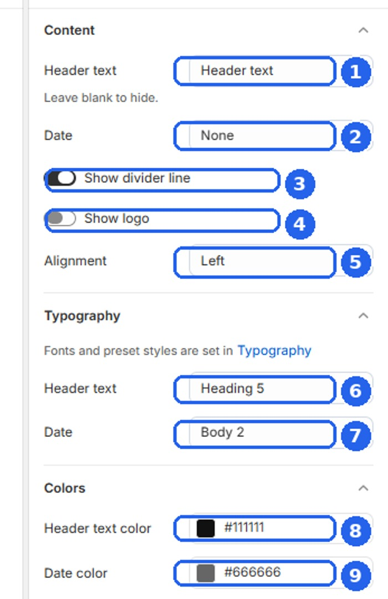
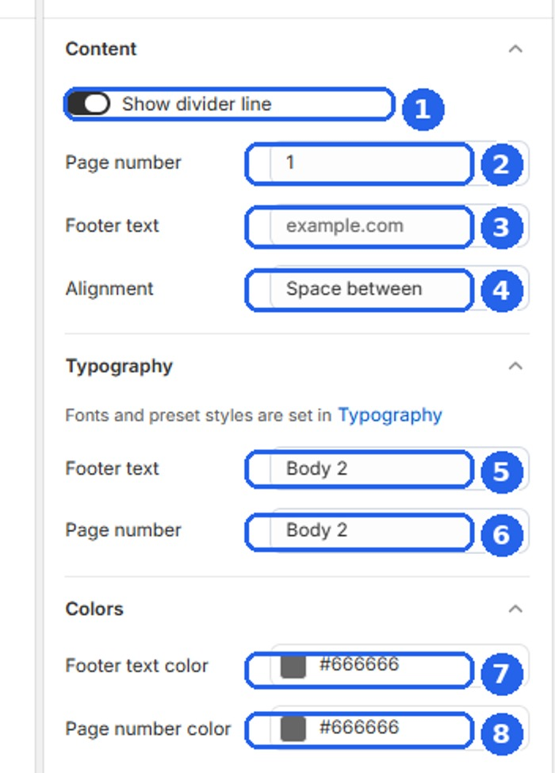
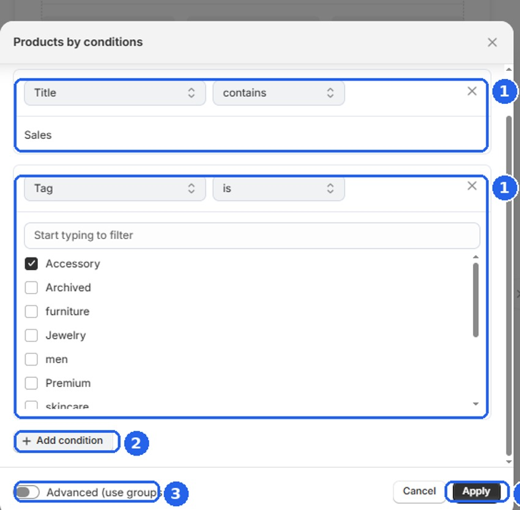
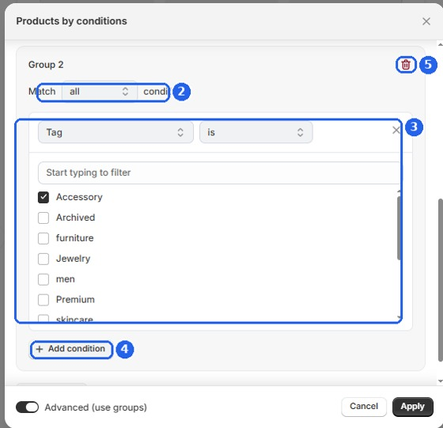

## Page name: How to set up the product page
Set your products, their layout, colors, and the page's header and footer.

---

# How to set up the product page

*Product source, Layout, Page colors, Header, Footer*

# Goal
Set up a product page: choose which products to show, set their layout and colors, and set the page's header and footer.

# Where to see & edit

| Where | Preview |
|---|---|
| In the Design editor, select a **Product section** page. |  |

# What you can do

| Steps (5) | Preview |
|---|---|
| **1. Choose your products** — set **Source** to **Products** to pick products yourself, or **Products by condition** to match them by rule (see below). |  |
| **2. Set the layout** — set **Columns**, **Rows**, **Space between cards**, and **Card style**. |  |
| **3. Set page colors** — set **Background** and **Dividers**. |  |
| **4. Set the header** — set **Header text**, **Date**, **Show divider line**, **Show logo**, and **Alignment**, plus their text style and color under **Typography** and **Colors**. |  |
| **5. Set the footer** — set **Show divider line**, **Page number**, **Footer text**, and **Alignment**, plus their text style and color under **Typography** and **Colors**. |  |

**Products by condition**

| Field | What it does |
|---|---|
| **Condition row** — pick a **Field** (e.g. Title, Tag), an **Operator** (e.g. contains, is), and a **Value**. |  |
| **+ Add condition** — add another rule to the current group. | |
| **Match** — choose: &nbsp;&nbsp;▸ **All** — every condition must match &nbsp;&nbsp;▸ **Any** — at least one must match | |
| **Apply** — save the conditions. | |

- Turn on **Advanced (use groups)** to split conditions into separate groups, each with its own **All**/**Any** match (see below).

**Advanced (use groups)** — turn this on to split your conditions into separate groups, each matched on its own.

| Field | What it does | Preview |
|---|---|---|
| **1. Match** — at the top, choose: &nbsp;&nbsp;▸ **All** — every group must match &nbsp;&nbsp;▸ **Any** — at least one group must match | Each group repeats the same 4 controls. |  |
| **2. Match** (inside a group) — choose: &nbsp;&nbsp;▸ **All** — every condition in the group must match &nbsp;&nbsp;▸ **Any** — at least one must match | | |
| **3. Conditions** — the condition rows inside that group, same as above (Field, Operator, Value). | |  |
| **4. + Add condition** — add another rule to that specific group. | | |
| **5. Delete group** (trash icon) — remove that group. | | |

`[TBC: these 2 screenshots don't show an "Add group" button — confirm how a new group gets created before this part is final.]`

# Note
For individual blocks (Text, Shape, Image, and the rest), see their own guide pages at [documentations.rockcats.site/e/en/apps/rc-ctalog-maker](https://documentations.rockcats.site/e/en/apps/rc-ctalog-maker).
